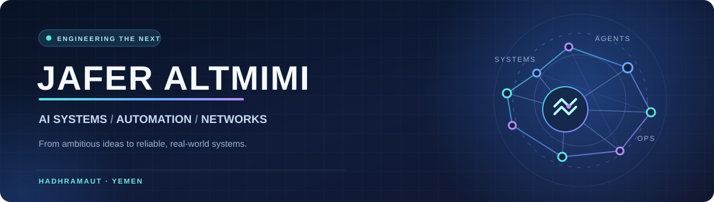

  

### 👋 Hi, I'm Jafer

**AI Systems Builder · Software Workflow Automation · Network Infrastructure**

I turn complex ideas into structured engineering workflows — bringing together **AI-assisted development**, **practical software tools**, and **real-world connectivity systems**.

---

## ✦ About Me

I'm interested in the space where **software engineering, intelligent automation, and infrastructure operations** meet. My work is driven by a simple idea: great systems should be thoughtfully designed, testable, secure, and genuinely useful.

- 🤖 **AI-driven engineering:** Developing structured, multi-agent workflows to support the software lifecycle.
- 🧩 **Software & automation:** Building practical tools and exploring Python- and Kotlin-based solutions.
- 🌐 **Network operations:** Working with internet infrastructure, wireless connectivity, routing, and service reliability.
- 🔍 **Engineering mindset:** Favoring evidence, maintainability, clear boundaries, and continuous improvement.

---

## 🚀 What I'm Building

<table>
<tr>
<td width="50%" valign="top">
<h3>🤖 AI Software Factory</h3>

<strong>Active, private development project</strong>

An evolving approach to software delivery that coordinates specialized AI agents across requirements, architecture, implementation, testing, security review, documentation, and release planning.

<strong>Focus:</strong> Agent orchestration · Quality gates · Traceability · Human oversight

</td>
<td width="50%" valign="top">
<h3>🌐 Network & Infrastructure Operations</h3>

<strong>Hands-on operational experience</strong>

Working on practical connectivity challenges involving routing, Wi-Fi distribution, user access management, performance diagnostics, and network reliability.

<strong>Focus:</strong> MikroTik · Ubiquiti · Starlink · Troubleshooting

</td>
</tr>
<tr>
<td width="50%" valign="top">
<h3>🛠️ Python Tools & Dashboards</h3>

Experimenting with Python-based utilities, clear data visualization, and operational dashboards that make complex workflows easier to understand.

</td>
<td width="50%" valign="top">
<h3>📱 Android & Kotlin</h3>

Exploring Android applications, background services, and device-side workflows with Kotlin and Android Studio.

</td>
</tr>
</table>

> **A note on my projects:** Some work is intentionally kept private while it is being developed and reviewed. Public repositories and demonstrations will be linked here when available.

---

## 🧰 My Technical Toolkit

**Development & Version Control**

**AI & Engineering Workflows**

**Networking & Infrastructure**

<strong>🌱 Technologies and practices I'm exploring</strong>

Agentic coding tools, local AI workflows, containerized development, test automation, Android architecture, and improved developer tooling.

---

## 🧭 How I Approach Engineering

| Principle | What it means to me |
| :-- | :-- |
| **Evidence over assumptions** | Verify outcomes with tests, logs, and reproducible results. |
| **Design before scale** | Establish clear boundaries and maintainable architecture. |
| **Security by design** | Make review, access control, and risk evaluation part of the process. |
| **Human-led AI** | Use AI to accelerate work while preserving human responsibility for important decisions. |
| **Practical impact** | Build for real users, real constraints, and real operating conditions. |

---

## 🎯 Current Direction

I'm focused on strengthening my **AI-assisted engineering workflow**, improving the **testing and integration discipline** behind it, and creating software tools that connect automation with operational needs.

### Build carefully. Verify continuously. Improve deliberately.

**صناعة الأنظمة تبدأ بفكرة، وتنجح بالدقة والتجربة والتطوير المستمر.**

[Explore my GitHub profile →](https://github.com/JaferAltmimi)

